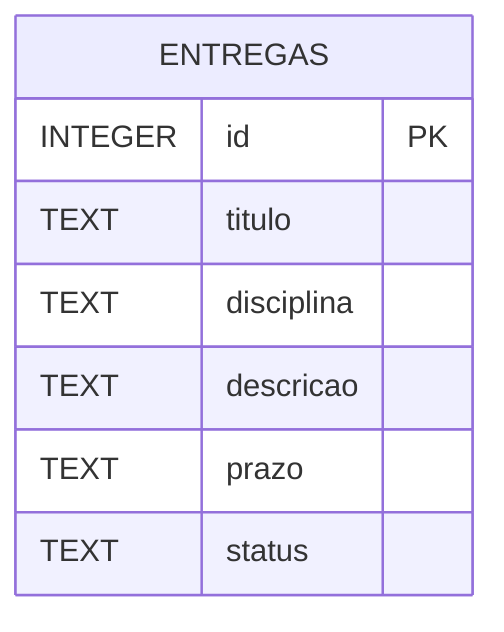

# Modelo de Dados

O sistema tem uma única entidade. O banco é um arquivo SQLite criado automaticamente na primeira execução.



| Coluna | Tipo | Observações |
|--------|------|-------------|
| id | INTEGER | Chave primária, autoincremento |
| titulo | TEXT | Obrigatório (RN01) |
| disciplina | TEXT | Obrigatório (RN01) |
| descricao | TEXT | Opcional, padrão vazio |
| prazo | TEXT | Data no formato ISO `AAAA-MM-DD` (RN02); permite ordenar e comparar como texto |
| status | TEXT | `pendente` ou `concluida`, com restrição `CHECK` |

## Organização do código

```
src/
├── main.py              ponto de entrada
└── entregas/
    ├── cli.py           interpreta comandos e imprime resultados
    ├── service.py       regras de negócio e consultas
    └── db.py            conexão e criação da tabela
```